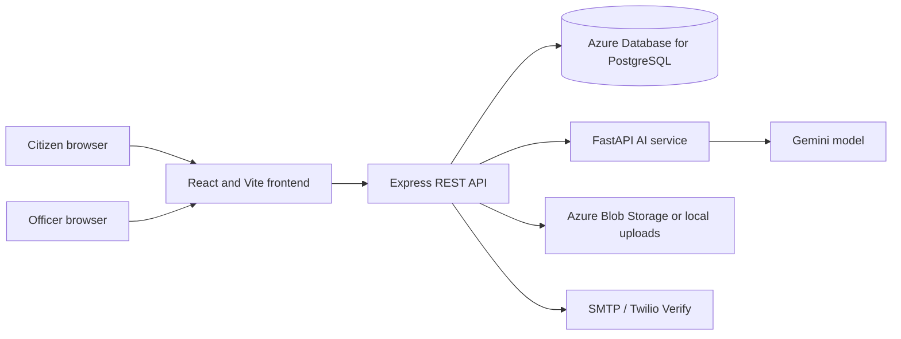
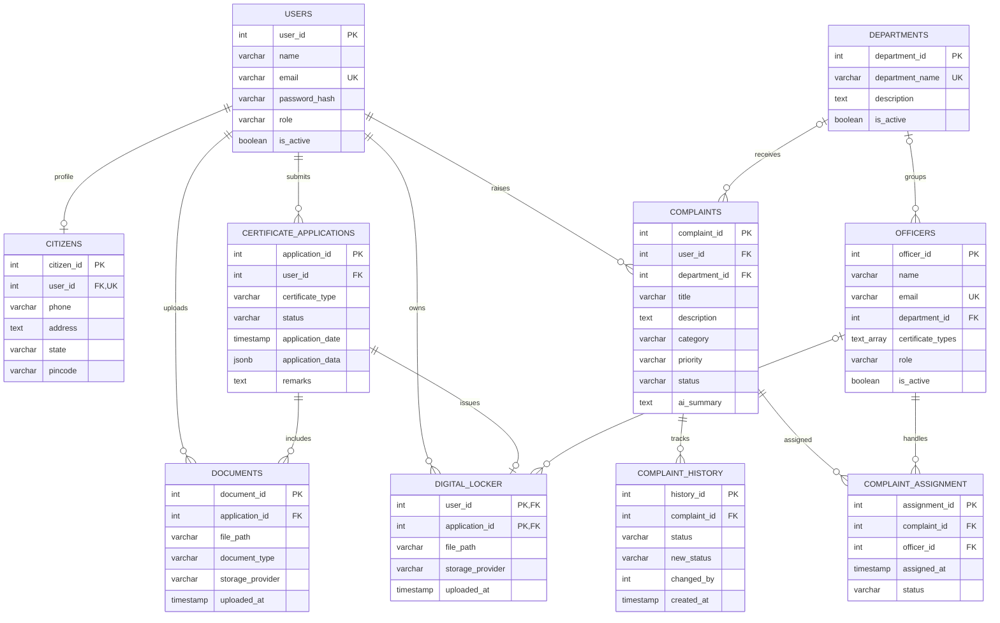
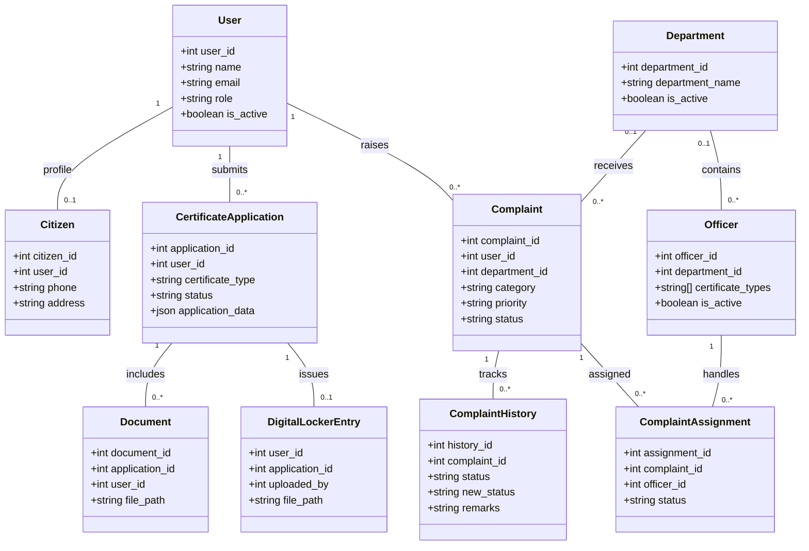

# GovBridge AI: Government Digital Services Platform

**Repository:** [https://github.com/CortexCrew/GovBridge_AI](https://github.com/CortexCrew/GovBridge_AI)

## Team

Team member names, student IDs, and individual contributions were not included in the repository materials. Add the verified team details before submission; do not leave placeholder identities in the final project report.

| Team member | Student / ID | Contribution |
| --- | --- | --- |

| To be supplied by the project team | To be supplied | To be supplied |
## Project Overview

GovBridge AI is a web application for citizen-facing government services. Citizens can manage a profile, apply for supported certificates, upload supporting documents, and submit complaints. An AI service classifies complaint text, assigns a department and priority, and generates a short summary. Officers authenticate separately and view work scoped to their department and the certificate types they handle.

### Introduction and problem statement


### Project objectives

- Provide authenticated citizen and officer workflows.
- Store certificate requests, uploaded documents, complaints, assignments, and status history in PostgreSQL.
- Restrict officer views using authenticated role, department, and certificate-type data.
- Use AI to classify complaints and map the returned department name to a database department ID.


### Current scope
The repository contains authentication and profiles, certificate applications and reviews, document storage, a digital locker, complaints, complaint assignment and history, department/officer workflows, and an AI complaint service. Email, OTP, cloud storage, and AI provider integrations require corresponding credentials and configuration. Officer accounts are provisioned administratively; the application does not provide public officer registration.

## System Requirements

- Git and Node.js 20.19+ or 22.12+ (with npm), as required by the Vite 8 frontend toolchain.
- Python 3.10 or later and pip for the AI service.
- An Azure Database for PostgreSQL server and database. The current backend validates that `DB_HOST` is an Azure PostgreSQL hostname and requires `DB_SSL=true`; a local PostgreSQL hostname will fail startup without a code change.
- A Gemini API key for live complaint analysis.
- A modern browser. Azure Blob Storage, Twilio Verify, and SMTP credentials are needed only for the corresponding integrations.

## Architecture



The frontend calls the Express API under `/api`. The API validates requests, authenticates JWTs, enforces role checks, and performs parameterized PostgreSQL queries. On startup, the backend connects to the configured database, creates or updates tables through repository initialization code, and inserts the fixed department list if missing. Complaint analysis is sent to the FastAPI `/analyze` endpoint, which calls Gemini and returns JSON for persistence.

### Repository components

| Path | Responsibility |
| --- | --- |
| `Frontend/` | React 19 and Vite citizen/officer interface |
| `Backend/` | Express API, PostgreSQL access, authentication, certificates, complaints, locker, officers |
| `ai_service/` | FastAPI complaint classification service |
| `Backend/tests/` | Node.js built-in test-runner tests |
| `TEST_VALIDATION_GUIDE.md` | Detailed manual checks for complaint department mapping |

## Database Design

### Methodology

The design uses generated integer primary keys, foreign keys for ownership and lookup relationships, and uniqueness/check constraints for key business rules. Write operations that must remain consistent use database transactions. SQL values supplied at runtime use positional parameters. Lookup entities such as departments are stored separately to avoid repeating department names in normal application relationships. Certificate-specific form values use PostgreSQL `JSONB` because each certificate type can have different fields.

### ER diagram

This diagram reflects the tables and relationships initialized by the current backend. `department` remains as a legacy text column in `complaints`; current AI processing also writes the normalized `department_id` foreign key.




### UML class diagram

The class view presents the main domain entities and their associations; it is a documentation view of the database-backed model, not a claim that each entity is implemented as a JavaScript class.



### Relational schema mapping

`PK` means primary key, `FK` foreign key, and `UK` unique constraint. Timestamp and audit columns are omitted below when they are not central to the relationship.

| Relation | Key attributes and mapping |
| --- | --- |
| `users` | `user_id` PK; `email` UK; identity, password hash, role, active flag |
| `citizens` | `citizen_id` PK; `user_id` FK to `users`, also UK for the one-to-one citizen profile; contact/address fields |
| `departments` | `department_id` PK; `department_name` UK; description and active flag |
| `officers` | `officer_id` PK; nullable `department_id` FK to `departments`; `certificate_types` is a PostgreSQL text array |
| `certificate_applications` | `application_id` PK; `user_id` FK to `users`; constrained certificate type and status; `application_data` JSONB |
| `documents` | `document_id` PK; `application_id` FK to `certificate_applications`; `user_id` FK to `users`; file metadata |
| `digital_locker` | Composite PK (`user_id`, `application_id`); both are FKs to `users` and `certificate_applications`; nullable `uploaded_by` FK to `officers` |
| `complaints` | `complaint_id` PK; `user_id` FK to `users`; nullable `department_id` FK to `departments`; complaint fields and AI result |
| `complaint_history` | `history_id` PK; `complaint_id` FK to `complaints`; status transition and remarks; `changed_by` is currently not declared as an FK |
| `complaint_assignment` | `assignment_id` PK; `complaint_id` FK to `complaints`; `officer_id` FK to `officers`; assignment status |

### Functional dependencies

The principal dependencies implied by the primary and unique keys are:

- `users.user_id -> name, email, password_hash, role, is_active, created_at, updated_at`; `users.email -> user_id, name, password_hash, role, is_active, created_at, updated_at`.
- `citizens.citizen_id -> user_id, phone, address, city, state, pincode`; `citizens.user_id -> citizen_id, phone, address, city, state, pincode` because `user_id` is unique.
- `departments.department_id -> department_name, description, is_active`; `departments.department_name -> department_id, description, is_active`.
- `officers.officer_id -> name, email, password_hash, department_id, certificate_types, role, is_active`.
- `certificate_applications.application_id -> user_id, certificate_type, status, application_date, application_data, remarks`.
- `documents.document_id -> application_id, user_id, file_path, document_type, file metadata, uploaded_at`.
- `(digital_locker.user_id, digital_locker.application_id) -> file_path, uploaded_by, file metadata, storage_provider, uploaded_at`.
- `complaints.complaint_id -> user_id, department_id, title, description, category, priority, status, AI summary, timestamps`.
- `complaint_history.history_id -> complaint_id, status, new_status, remarks, changed_by, created_at`.
- `complaint_assignment.assignment_id -> complaint_id, officer_id, assigned_at, status`.

### Normalization

The core tables use surrogate primary keys, and separate user, citizen, department, application, document, complaint, and history relations reduce repeating groups and update anomalies. With the declared keys and scalar columns, the core relations are designed to satisfy 3NF: non-key columns describe their relation's key rather than another non-key attribute. Foreign keys enforce ownership and lookup consistency.

Two deliberate flexibility choices are worth noting in a formal normalization discussion: `officers.certificate_types` is a PostgreSQL array rather than a separate officer-certificate junction relation, and certificate-specific fields are held in `application_data` JSONB. These are convenient for the current application but are not fully atomic in a strict relational model. A future design requiring constraints/reporting per certificate type could replace the array with an `officer_certificate_types(officer_id, certificate_type)` relation. `complaint_history` separately records status changes instead of overwriting the only status value.

## Advanced SQL Queries

All examples use PostgreSQL and positional parameters. Pass values through the database driver; do not concatenate user input into SQL.

### 1. Department workload with readable names

Purpose: compare complaint volumes and open workload across active departments, including departments with zero complaints.

```sql
SELECT d.department_id,
      d.department_name,
      COUNT(c.complaint_id) AS total_complaints,
      COUNT(c.complaint_id) FILTER (WHERE c.status = 'Pending') AS pending_complaints
FROM departments AS d
LEFT JOIN complaints AS c ON c.department_id = d.department_id
WHERE d.is_active = TRUE
GROUP BY d.department_id, d.department_name
ORDER BY pending_complaints DESC, d.department_name;
```

### 2. Complaint status timeline

Purpose: retrieve the chronological audit trail for one complaint.

```sql
SELECT complaint_id, status AS previous_status, new_status, remarks, changed_by, created_at
FROM complaint_history
WHERE complaint_id = $1
ORDER BY created_at ASC, history_id ASC;
```

### 3. Officer work queue

Purpose: show pending certificate applications matching one officer's configured certificate types; `ANY` tests membership in the stored PostgreSQL array.

```sql
SELECT ca.application_id, ca.certificate_type, ca.status, ca.application_date, u.name, u.email
FROM officers AS o
JOIN certificate_applications AS ca
  ON ca.certificate_type = ANY(o.certificate_types)
JOIN users AS u ON u.user_id = ca.user_id
WHERE o.officer_id = $1
  AND o.is_active = TRUE
  AND ca.status = 'Pending'
ORDER BY ca.application_date ASC;
```

### 4. Complaint assignment details

Purpose: inspect assignments for a complaint with the assigned officer and department names.

```sql
SELECT a.assignment_id, a.status AS assignment_status, a.assigned_at,
      o.officer_id, o.name AS officer_name, d.department_name
FROM complaint_assignment AS a
JOIN officers AS o ON o.officer_id = a.officer_id
LEFT JOIN departments AS d ON d.department_id = o.department_id
WHERE a.complaint_id = $1
ORDER BY a.assigned_at DESC;
```

### 5. AI department mapping check

Purpose: confirm that an AI-returned department name resolves to an active department ID despite case or surrounding whitespace differences.

```sql
SELECT department_id, department_name
FROM departments
WHERE LOWER(TRIM(department_name)) = LOWER(TRIM($1))
  AND is_active = TRUE
LIMIT 1;
```

## Installation and Setup

### 1. Clone the repository

```powershell
git clone https://github.com/CortexCrew/GovBridge_AI.git
cd GovBridge_AI
```

### 2. Provision and configure PostgreSQL

Create an Azure Database for PostgreSQL server and database, allow the development machine through the server firewall, and use SSL. The backend creates its application tables on startup; there is no separate SQL migration or schema seed file in this repository. Startup also inserts the fixed department lookup rows if they are missing. It does not create sample citizens or officers.

Create `Backend/.env` (this file is ignored by Git) with the required settings. Use your own values and keep secrets out of source control:

```dotenv
PORT=5000
NODE_ENV=development
DB_HOST=<your-server>.postgres.database.azure.com
DB_PORT=5432
DB_NAME=<your-database>
DB_USER=<your-database-user>
DB_PASSWORD=<your-database-password>
DB_SSL=true
JWT_SECRET=<long-random-secret>
AI_SERVICE_URL=http://localhost:8000
```

Configure optional `EMAIL_*`, `TWILIO_*`, and Azure Blob Storage settings in this file only when using those integrations. The backend's environment validator requires an Azure PostgreSQL hostname and `DB_SSL=true`.

### 3. Configure and run the AI service

In a separate PowerShell terminal:

```powershell
cd ai_service
python -m venv .venv
.\.venv\Scripts\Activate.ps1
pip install -r requirements.txt
```

Create `ai_service/.env` containing a valid key:

```dotenv
GEMINI_API_KEY=<your-gemini-api-key>
```

Start the service:

```powershell
python -m uvicorn app.main:app --reload --port 8000
```

The service health response is available at `http://localhost:8000/`; interactive API documentation is at `http://localhost:8000/docs`.

### 4. Configure and run the backend

In another terminal:

```powershell
cd Backend
npm install
npm run dev
```

The API listens on `http://localhost:5000`. On successful startup, it connects to PostgreSQL and initializes the module tables. If startup fails, verify the Azure PostgreSQL hostname, firewall access, credentials, and SSL setting.

### 5. Configure and run the frontend

In another terminal:

```powershell
cd Frontend
npm install
```

Create `Frontend/.env.local` to direct the UI to the local API:

```dotenv
VITE_API_BASE_URL=http://localhost:5000/api
```

Start Vite:

```powershell
npm run dev
```

Open the local URL printed by Vite, normally `http://localhost:5173`.

## Demonstration and Reproducing the Database State

1. Start the AI service, backend, and frontend in separate terminals as described above.
2. Confirm the backend has logged a successful database connection and table initialization. The `departments` table should contain the 13 department names from `ai_service/app/prompt.py`.
3. Register a citizen using the UI or `POST /api/auth/register`. Complete the configured OTP flow if enabled, then sign in using `POST /api/auth/login` and retain the returned bearer token for API checks.
4. Submit a complaint from the citizen portal or call `POST /api/complaints` with the citizen token. The AI service should return category, priority, department, and summary; the backend maps the department name to `department_id`.
5. Inspect the resulting complaint and department using the verification query below. Create certificate applications and upload supporting files through the UI to demonstrate those workflows.
6. For officer demonstrations, use an officer account provisioned by the database administrator with a valid password hash, department, and certificate types. Officer records are not seeded by backend startup.

Example complaint request:

```http
POST http://localhost:5000/api/complaints
Authorization: Bearer <citizen-token>
Content-Type: application/json
```

```json
{
  "title": "Pothole near the college",
  "description": "A large pothole near the college is creating a road safety risk."
}
```

Example response shape (IDs and AI text vary by database state/model response):

```json
{
  "success": true,
  "data": {
   "complaint_id": 1,
   "title": "Pothole near the college",
   "category": "Road",
   "priority": "High",
   "department_id": 9,
   "status": "Pending",
   "ai_summary": "Road damage reported near the college."
  }
}
```

Verify the persisted result with `psql` or a database client:

```sql
SELECT c.complaint_id, c.title, c.category, c.priority, c.status,
      c.department_id, d.department_name, c.ai_summary
FROM complaints AS c
LEFT JOIN departments AS d ON d.department_id = c.department_id
ORDER BY c.created_at DESC
LIMIT 10;
```

For a repeatable clean demonstration, use a dedicated non-production database. The startup code creates missing tables and lookup departments, but does not reset existing data or seed test users; remove/reset demo records only through an approved database procedure. AI output can vary, so validate the mapped department and persisted fields rather than expecting identical generated wording.

## Test Cases and Validation

### Automated tests

From `Backend/`, after creating a valid `Backend/.env` for configuration loading, run:

```powershell
node --test tests/*.test.js
```

The tests cover identifier and OTP validation, target masking, OTP cooldown/attempt behavior, certificate-type validation, officer certificate eligibility, dashboard filtering by department and certificate type, and rejection of inactive officers. These unit tests stub repository calls and do not replace a live database/API integration test. The current `npm test` script is a placeholder; use the command above.

### Complaint department-mapping validation

The full manual test guide is in [TEST_VALIDATION_GUIDE.md](TEST_VALIDATION_GUIDE.md). Validate these cases against a dedicated test database and controlled AI responses:

| Case | Expected result |
| --- | --- |
| Exact department name | Complaint stores the matching `department_id` |
| Different letter case | Active department is still found |
| Leading/trailing whitespace | Active department is still found |
| Unknown department | Processing returns an error and incomplete complaint is removed |
| Inactive department | No inactive department is assigned |

Example check for an exact or normalized name:

```sql
SELECT department_id
FROM departments
WHERE LOWER(TRIM(department_name)) = LOWER(TRIM('Public Works Department'))
  AND is_active = TRUE;
```

To confirm the full relationship after submission:

```sql
SELECT c.complaint_id, c.title, c.department_id, d.department_name
FROM complaints AS c
LEFT JOIN departments AS d ON d.department_id = c.department_id
WHERE c.complaint_id = $1;
```

### Screenshots and result files

No application screenshots or exported result files are currently checked into the repository. The JSON and SQL examples above are representative sample outputs; record actual results during a demonstration and add screenshots under a documentation image directory if required by the project submission rubric.

## Project Report

The project report PDF was not present in the supplied workspace, so it could not be updated here. Include this repository URL in the report PDF: [https://github.com/CortexCrew/GovBridge_AI](https://github.com/CortexCrew/GovBridge_AI). The report should cover the same overview, architecture, database diagrams, relational mapping, normalization, SQL, setup, and validation topics documented above.

## Security Notes

- Never commit `.env`, API keys, database passwords, JWT secrets, OTP provider credentials, or storage connection strings. `.gitignore` excludes the local environment files.
- Use a dedicated demo database and non-production credentials for demonstrations.
- Authorization must be derived from the authenticated JWT and server-side role/department checks; do not trust a client-supplied `officer_id` or `department_id`.
